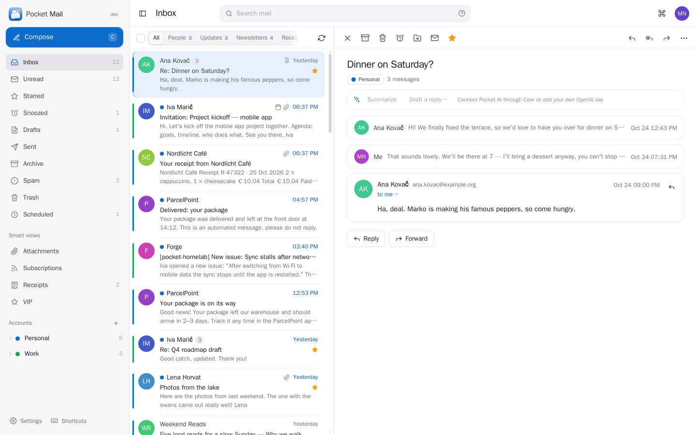
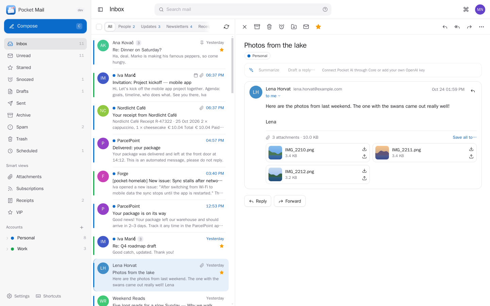
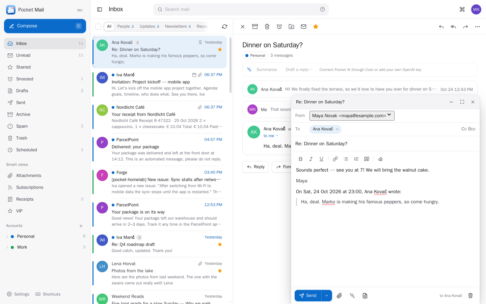
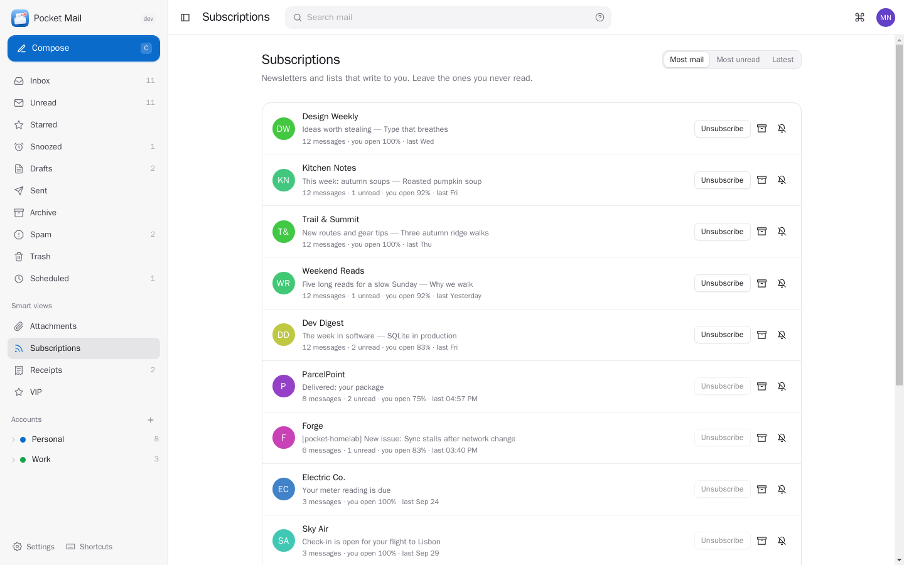
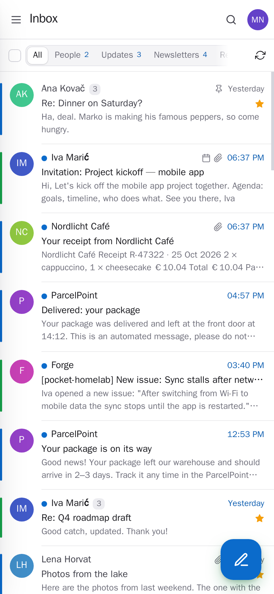
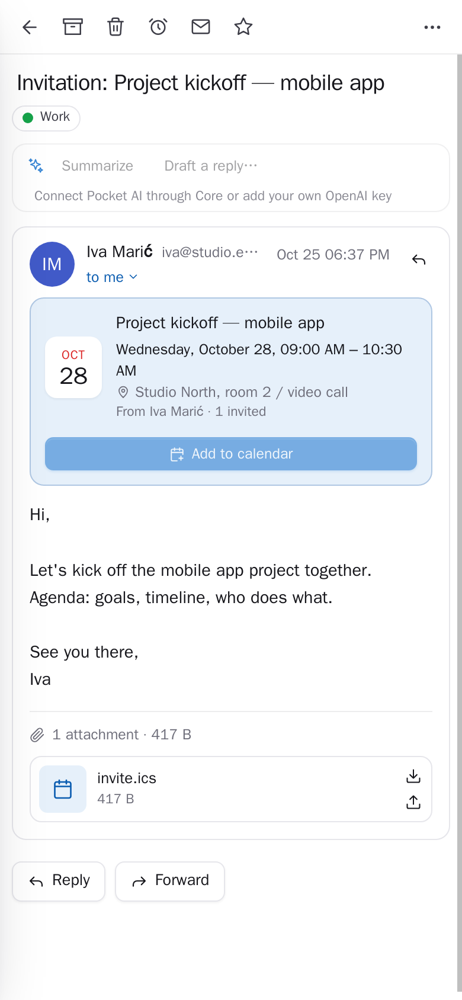

<p align="center"></p>
<h1 align="center">Pocket Mail</h1>
<p align="center">All your email in one calm inbox. Gmail, iCloud, Outlook, Yahoo, Fastmail and any IMAP account side by side, with conversations, instant search, snooze, send later and undo send, one-click unsubscribe, rules, templates and remote images blocked until you say so. Attachments go straight to Pocket Documents, Files or your photo library, an email becomes a task, a calendar event, a note or an expense in one click, and Pocket AI summarizes long threads and helps you write.<br>One Go binary, one SQLite file, one volume. Part of the Pocket apps; works on its own too.</p>
<p align="center">
  <a href="https://github.com/abjelosevic88/pocket-homelab-email/actions"></a>
  <a href="https://github.com/abjelosevic88/pocket-homelab-email/pkgs/container/pocket-homelab-email"></a>
  <a href="LICENSE"></a>
</p>

---

<p align="center"></p>

<table>
  <tr>
    <td width="50%"></td>
    <td width="50%"></td>
  </tr>
  <tr>
    <td align="center"><sub>Read a whole conversation; save attachments, make a task or an event right from it.</sub></td>
    <td align="center"><sub>Write with suggestions from your contacts, templates, send later and undo send.</sub></td>
  </tr>
  <tr>
    <td width="50%"></td>
    <td width="50%"></td>
  </tr>
  <tr>
    <td align="center"><sub>Subscriptions: see who fills your inbox and leave with one click.</sub></td>
    <td align="center"><sub>Add an account by typing the address; Gmail and Outlook sign in with Google or Microsoft.</sub></td>
  </tr>
</table>

<p align="center">
  &nbsp;&nbsp;
  
</p>

## What it does

- **Every account in one place**: type your address and Pocket Mail finds the servers (built-in providers, Thunderbird's provider database, the domain's mail servers). Gmail and Google Workspace sign in with Google, Outlook.com and Microsoft 365 with Microsoft; iCloud, Yahoo, Fastmail and others with an app password, with a link to where you make one. A unified inbox, or one account at a time with all its folders.
- **A calm inbox**: conversations grouped like a chat, the inbox split into People, Updates, Newsletters and Receipts, pinned messages on top, snooze until later today, tomorrow or next week, and new mail arriving live without the list jumping.
- **Search that finds it**: words in subjects, names and text (accents ignored), plus `from:`, `to:`, `has:attachment`, `is:unread`, `before:`, `newer_than:7d`, `filename:` and more.
- **Writing**: address suggestions from Pocket Contacts and the people you write with, rich text, signatures per account, templates, drag-and-drop attachments (or straight from Pocket Files and Documents), send later, undo send, and a gentle "did you forget the attachment?".
- **Safe reading**: messages are cleaned before they are shown, tracking images and remote content stay blocked until you allow them (once, or always for a sender), and attachments that could run code are only downloaded.
- **Less noise**: a Subscriptions page with every newsletter and how much it sends, one-click unsubscribe (RFC 8058) or an unsubscribe mail sent for you, archive everything from a sender, mute or mark VIPs, and rules that file, mark, star or hand attachments to your Pocket apps as mail arrives.
- **Your Pocket apps, one click away**: save attachments or the whole email to Pocket Documents, Files or Immich photos, make a Pocket Tasks task or a Pocket Notes note that links back to the email, add invitations to Pocket Calendar (and see what else is on that day), record a receipt in Pocket Money, add a sender to Pocket Contacts. Each message shows what was made from it.
- **AI when you want it**: summarize a long thread, three quick replies, "draft a reply that says yes but not before Friday", improve, shorten, make it friendlier or translate what you wrote, pull tasks, dates and amounts out of a message, and a short "catch me up" on what came in — with Pocket AI or your own OpenAI-compatible key.
- **Everyone their own**: each person has their own accounts, mail, settings and connections; admins see no one else's mail. Passwords and tokens are sealed with a key only this server has.

## Run it

```sh
docker run -d --name pocket-mail -p 8080:8080 -v ./data:/data \
  -e BASE_URL=https://mail.example.com -e SECURE_COOKIES=true \
  ghcr.io/abjelosevic88/pocket-homelab-email:latest
```

or `docker compose up -d` with [docker-compose.yml](docker-compose.yml). Open it, create the first account and add your mail. All options, and how to set up Google and Microsoft sign-in: [docs/configuration.md](docs/configuration.md). API: [docs/api.md](docs/api.md). Back up `DATA_DIR` including `secret.key` ([docs/backup.md](docs/backup.md)).

Your mail stays with your mail provider: Pocket Mail keeps a copy of the recent months (you choose how many) for speed and search, and every change you make goes back to the server, so your phone's mail app sees the same thing.

## With Pocket Core

Set `CORE_URL` and `CORE_REGISTRATION_KEY` and Mail joins the box: people sign in with Pocket Core, and through app links each person's mail reaches their own Pocket apps with nothing to paste — Documents, Files, Tasks, Calendar, Contacts, Notes, Money, their Immich login and Pocket AI. Other Pocket apps can read your mail (`mail:read`: Pocket Day, dashboards, Pocket AI) or send from your account (`mail:send`: an invoice from Pocket Invoicing, a book to your Kindle from Pocket Library). Events on the bus: `mail.received`, `mail.sent`. Without Core every connection can be made directly with a URL and a token; the Core-only choices stay visible, greyed out.

## Develop

```sh
make dev     # API on :8080 with demo accounts + Vite on :5173
make test    # go vet, go test, tsc
make         # web + binary
```

MIT licensed.
